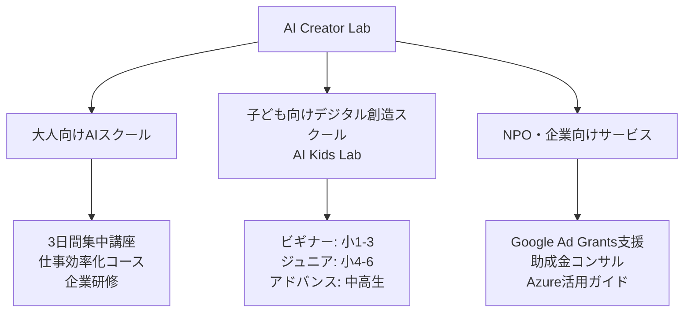
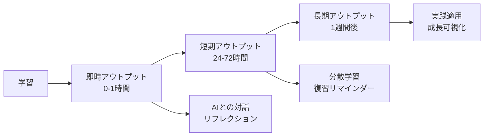
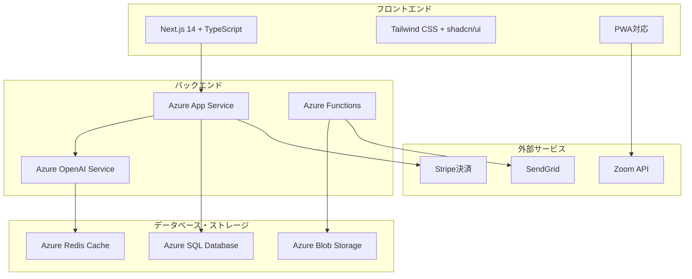
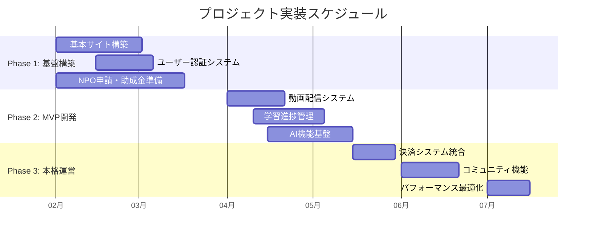
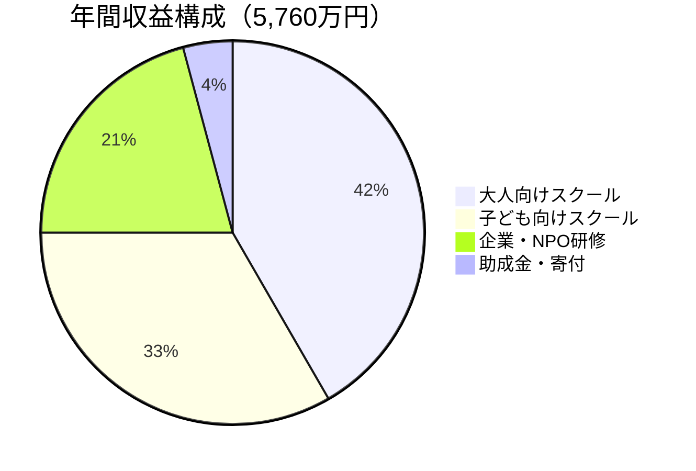
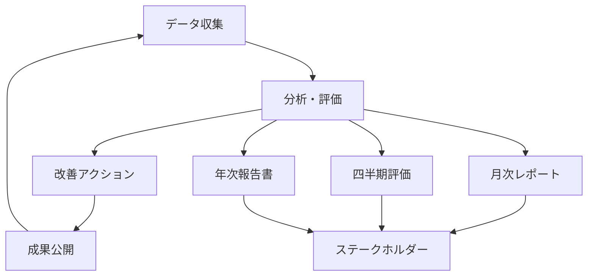

# AI Creator Lab プロジェクト総合資料

## 📋 目次

1. [プロジェクト概要](#プロジェクト概要)
2. [事業構成](#事業構成)
3. [教育理念とアプローチ](#教育理念とアプローチ)
4. [技術アーキテクチャ](#技術アーキテクチャ)
5. [各事業の詳細](#各事業の詳細)
6. [NPO法人としての特典活用戦略](#npo法人としての特典活用戦略)
7. [段階的展開計画](#段階的展開計画)
8. [財務計画とリソース](#財務計画とリソース)
9. [リスク管理と持続可能性](#リスク管理と持続可能性)
10. [パートナーシップ戦略](#パートナーシップ戦略)
11. [成功指標と効果測定](#成功指標と効果測定)

---

## プロジェクト概要

### 🌟 ビジョン
**「AIで未来を創る学びの場 - すべての人にAI時代を生き抜く力を」**

### 🎯 ミッション
- AI技術を活用した革新的な教育プラットフォームの提供
- 教育格差の解消と社会包摂の実現
- デジタル創造力と21世紀型スキルの育成
- 地域コミュニティと連携した持続可能な教育エコシステムの構築

### ⭐ コアバリュー
- **Personalization（個別最適化）**: 一人ひとりに寄り添う教育
- **Collaboration（協働）**: 共に学び、共に成長する環境
- **Innovation（革新）**: 常に新しい学びを追求
- **Inclusion（包摂）**: 誰一人取り残さない教育の実現
- **Sustainability（持続可能性）**: 未来につながる教育システム

---

## 事業構成

### 🏢 三つの主要事業ドメイン



### 📊 事業規模予測（3年後）
| 事業領域 | 年間受講生数 | 年間売上予測 |
|---------|-------------|-------------|
| 大人向けスクール | 800名 | 4,800万円 |
| 子ども向けスクール | 500名 | 3,600万円 |
| 企業・NPO向け | 50社/団体 | 3,000万円 |
| **合計** | **1,350名** | **1.14億円** |

---

## 教育理念とアプローチ

### 🧠 ハイブリッド学習理論の統合

本プラットフォームは、3つの学習理論を統合した独自のアプローチを採用：

#### 1. 行動主義的アプローチ - Foundation Layer
- **習慣化メカニズム**: 毎日のAI対話習慣の形成
- **反復学習**: スペースドリピティション（分散学習）の実装
- **即時フィードバック**: AIによる即座の応答と評価
- **ゲーミフィケーション**: 学習意欲の維持・向上

#### 2. 認知主義的アプローチ - Understanding Layer
- **メタ認知の育成**: 自己の学習プロセスの客観的理解
- **パーソナライズ**: Big Five性格分析による個別最適化
- **情報処理の可視化**: 学習進捗とパターンの見える化
- **認知負荷管理**: 個人の処理能力に応じた調整

#### 3. 構成主義的アプローチ - Creation Layer
- **探究型学習**: 学習者主導の問い立て
- **意味構築**: 個人の経験に基づく知識の構築
- **協働学習**: コミュニティでの対話と共創
- **プロジェクト型学習（PBL）**: 実社会の課題解決

### 🔄 3段階アウトプットシステム



### 🤖 AIの役割：学びの鏡として

#### セルフ・リフレクション支援
- 24時間365日利用可能な振り返りパートナー
- 中立的で判断しないフィードバック
- 無限の忍耐と一貫性

#### ソーシャル・リフレクション代替
- 他者視点のシミュレーション
- 多角的な質問生成
- 建設的な対話の促進

---

## 技術アーキテクチャ

### 🖥️ システム全体構成



### 💾 主要技術スタック

#### フロントエンド
- **Framework**: Next.js 14 (App Router)
- **Language**: TypeScript
- **Styling**: Tailwind CSS + shadcn/ui
- **State Management**: Zustand
- **Forms**: React Hook Form + Zod
- **Animation**: Framer Motion

#### バックエンド・インフラ
- **Platform**: Azure (NPO割引適用)
- **Runtime**: Node.js 18 / Python 3.11
- **AI Services**: Azure OpenAI Service
- **Database**: Azure SQL Database
- **Cache**: Azure Redis Cache
- **CDN**: Azure CDN

#### 開発・運用
- **Version Control**: Git + GitHub
- **CI/CD**: GitHub Actions
- **Monitoring**: Application Insights
- **Testing**: Jest + Playwright + Cypress

---

## 各事業の詳細

### 🎓 大人向けAIスクール

#### メイン講座：ChatGPT/Claude 仕事効率化 3日間集中講座

| 日程 | 内容 | 時間配分 | 学習目標 |
|------|------|----------|----------|
| **Day 1: 基礎編** | AIの仕組み、アカウント作成、基本操作、演習 | 30分×4セッション<br/>（計2時間） | AI基本操作マスター |
| **Day 2: 実践編** | 文書作成自動化、データ分析、画像生成連携 | 40分×3セッション<br/>（計2時間） | 業務効率化の実践 |
| **Day 3: 応用編** | カスタムGPT作成、API連携基礎、業務適用計画 | 40分×3セッション<br/>（計2時間） | 高度な活用法習得 |

#### 料金体系
- **基本プラン**: 49,800円（3日間講座・教材・修了証）
- **プレミアム**: 79,800円（基本 + 1ヶ月個別サポート）
- **企業研修**: 要相談（カスタマイズ研修・出張対応）

### 👶 子ども向けスクール（AI Kids Lab）

#### 年齢別プログラム構成

**🐣 ビギナーコース（小学1-3年生）**
```
平日 16:00-17:00 各コース1時間
月曜: AIとあそぼう（物語づくり、キャラクター作成）
火曜: はじめてのプログラミング（Scratch Jr.、Code.org）
水曜: デジタルアート（お絵かき、3Dモデリング）
木曜: ロボット・電子工作（micro:bit、LEGO）
金曜: 自由制作デー（発表会、協働制作）
```

**🚀 ジュニアコース（小学4-6年生）**
```
平日 16:30-18:00 各コース1.5時間
月曜: AI活用マスター（プロンプトエンジニアリング）
火曜: 本格プログラミング（Python、Web作成）
水曜: 3DCG・メタバース（Blender、VRChat）
木曜: STEM総合（Arduino、ドローン、IoT）
金曜: プロジェクト学習（PBL、地域課題解決）
```

**💫 アドバンスコース（中高生）**
```
土曜日 13:00-17:00 4時間集中講座
13:00-15:00: 専門技術（機械学習、Web開発、ゲーム）
15:00-17:00: キャリア開発（ポートフォリオ、起業体験）
```

#### 料金体系（スライディングスケール方式）
| 世帯区分 | 週1回 | 週2回 | 週3回以上 | オンラインのみ |
|----------|-------|-------|-----------|---------------|
| 通常世帯 | 8,000円/月 | 14,000円/月 | 18,000円/月 | 5,000円/月 |
| 低所得世帯 | 4,000円/月 | 7,000円/月 | 9,000円/月 | 2,500円/月 |
| 生活保護世帯 | 無料 | 1,000円/月 | 2,000円/月 | 無料 |

### 🏢 NPO・企業向けサービス

#### Google Ad Grants活用支援
- 月額$10,000（約150万円）の広告枠無料活用
- 申請から運用まで一貫サポート
- 年間1,800万円分の広告効果

#### 企業向けAI研修
- カスタマイズ研修プログラム
- 部門別特化研修（営業、マーケ、人事等）
- DX戦略策定支援

---

## NPO法人としての特典活用戦略

### 💰 年間コスト削減効果

| サービス | 通常料金 | NPO割引後 | 年間削減額 |
|----------|----------|------------|------------|
| **Azure インフラ** | 月50万円 | 月10万円 | 480万円 |
| **Google Ad Grants** | 月150万円 | 無料 | 1,800万円 |
| **Microsoft 365** | 月15万円 | 月3万円 | 144万円 |
| **開発ツール** | 月10万円 | 月2万円 | 96万円 |
| **合計削減額** | - | - | **2,520万円** |

### 🎯 活用可能な助成金

#### 確実性の高い助成金
| 助成団体 | 金額 | 対象事業 | 申請時期 |
|----------|------|----------|----------|
| 日本財団 子ども第三の居場所 | 最大3,000万円 | 居場所づくり事業 | 通年 |
| 子どもゆめ基金 | 300万円 | 体験活動・読書活動 | 年2回 |
| ベネッセこども基金 | 100-300万円 | 学び支援活動 | 年1回 |
| ソフトバンク つながる募金 | 500万円 | ICT活用教育 | 年2回 |

---

## 段階的展開計画

### 📅 6ヶ月実装スケジュール



### 🎯 フェーズ別目標

#### Phase 1: MVP（2ヶ月）
- 基本的なマーケティングサイト
- ユーザー登録・ログイン機能
- 簡易LMS機能
- **目標**: 無料体験会50名参加

#### Phase 2: 本格運営（2ヶ月）
- 完全なLMS実装
- 動画配信システム
- AI機能統合
- **目標**: 有料受講生100名獲得

#### Phase 3: スケール化（2ヶ月）
- 高度なAI機能
- モバイル対応（PWA）
- 分析・レポート機能
- **目標**: 受講生300名、月売上500万円

---

## 財務計画とリソース

### 💰 収益構造（年間）



#### 収入詳細
| 項目 | 年間金額 | 詳細 |
|------|----------|------|
| 大人向けスクール | 2,400万円 | 月20回×20名×6万円 |
| 子ども向けスクール | 1,920万円 | 160名×平均1万円×12ヶ月 |
| 企業研修 | 1,200万円 | 月2-3社×50万円 |
| 助成金・寄付 | 240万円 | 複数助成金 |
| **合計** | **5,760万円** |  |

#### 支出詳細
| 項目 | 年間金額 | 詳細 |
|------|----------|------|
| 人件費 | 2,160万円 | スタッフ8名分 |
| インフラ・システム | 480万円 | Azure、ソフトウェア |
| 教材・機材 | 360万円 | PC、教材開発 |
| 広告・マーケティング | 240万円 | SNS、体験会 |
| 施設・運営費 | 240万円 | 公民館利用料等 |
| 予備費 | 288万円 | リスク対応 |
| **合計** | **3,768万円** |  |
| **利益** | **1,992万円** | 再投資・拡大資金 |

### 👥 組織体制

| 役割 | 人数 | 雇用形態 | 月額費用 |
|------|------|----------|----------|
| 代表理事・統括責任者 | 1名 | 常勤 | 35万円 |
| 教育プログラム責任者 | 1名 | 常勤 | 30万円 |
| エンジニア（フルスタック） | 2名 | 常勤 | 50万円×2 |
| 講師・メンター | 3名 | 非常勤 | 15万円×3 |
| 事務・運営 | 1名 | 常勤 | 25万円 |

---

## リスク管理と持続可能性

### ⚠️ リスク分析マトリックス

| リスク項目 | 影響度 | 発生確率 | 対策 |
|-----------|-------|---------|------|
| AI技術の急速な変化 | 高 | 高 | 技術トレンド追跡、柔軟なアーキテクチャ |
| 競合の参入 | 中 | 高 | 差別化機能強化、先行者優位確保 |
| 助成金の減少 | 中 | 中 | 収益源多様化、自立採算化 |
| 人材確保困難 | 高 | 中 | 大学連携、リモートワーク活用 |
| 法規制の変化 | 中 | 低 | 法務相談、コンプライアンス体制 |

### 🔄 持続可能性戦略

#### 収益源の多様化
1. **主力事業**: 教育サービス（70%）
2. **補完事業**: コンサルティング（20%）
3. **安定収入**: 助成金・寄付（10%）

#### 社会的インパクトの最大化
- 教育格差是正への貢献
- 地域コミュニティ活性化
- デジタルリテラシー向上

---

## パートナーシップ戦略

### 🤝 戦略的連携先

#### 教育機関
- **大学**: 研究連携、学生インターン受入
- **専門学校**: カリキュラム共同開発
- **教育委員会**: 不登校支援連携

#### テクノロジー企業
- **Microsoft**: Azure NPO支援、技術協力
- **Google**: Google for Education連携
- **地域IT企業**: 技術支援、CSR連携

#### 地域コミュニティ
- **公民館・コミュニティセンター**: 場所提供、運営協力
- **地域NPO**: 相互送客、共同事業
- **保護者会**: 運営参画、口コミ拡散

#### 行政・財団
- **文部科学省**: 実証事業採択
- **経済産業省**: EdTech補助金
- **民間財団**: 教育関連助成金

---

## 成功指標と効果測定

### 📊 KPI体系

#### 事業指標
| 指標 | 3ヶ月 | 6ヶ月 | 1年後 |
|------|-------|-------|-------|
| 総受講生数 | 50名 | 150名 | 400名 |
| 月間売上 | 200万円 | 400万円 | 800万円 |
| 顧客満足度 | 4.0/5.0 | 4.3/5.0 | 4.5/5.0 |
| 受講継続率 | 80% | 85% | 90% |

#### 社会的インパクト指標
- **教育格差是正**: 低所得世帯受講生比率30%維持
- **デジタルリテラシー向上**: 受講後スキルテスト平均30%向上
- **地域貢献**: 地域イベント月1回開催
- **就職・進学支援**: 進路実現率90%以上

#### 技術指標
- **システム稼働率**: 99.9%以上
- **ページ読み込み速度**: 3秒以内
- **セキュリティ**: 重大インシデント0件
- **AI応答品質**: 4.5/5.0以上

### 📈 成果の可視化



---

## プロジェクトの社会的意義

### 🌟 変革のビジョン

AI Creator Labは、単なる教育事業を超えた**社会変革プラットフォーム**として設計されています。

#### 教育改革への貢献
- 文科省方針「個別最適な学び」の実装モデル提示
- AI時代に必要な新しい教育手法の確立
- 民間教育の新たな可能性の探求

#### 社会包摂の実現
- 経済格差による教育機会の不平等解消
- デジタル格差の是正
- 多様なニーズに対応する学習環境の提供

#### 地域活性化
- 地域コミュニティとの連携強化
- 地方創生・人材還流の促進
- 持続可能な地域教育モデルの構築

### 🚀 未来への展望

3年後には、このモデルを全国に展開し、最終的には海外への輸出も視野に入れています。

**「AI Creator Lab発、世界標準の教育モデル」**として、日本発の教育イノベーションを世界に発信することが私たちの最終目標です。

---

## まとめ

AI Creator Labは、AIテクノロジーと教育理論を融合させた革新的なハイブリッド学習プラットフォームです。

### 💎 プロジェクトの核心価値
1. **技術的革新**: 最新AI技術の教育への実装
2. **教育的価値**: 確立された学習理論に基づく設計
3. **社会的意義**: 教育格差解消と包摂的社会の実現
4. **経済的持続可能性**: NPO特典を活用した効率的運営
5. **スケーラビリティ**: 全国・海外展開可能な仕組み

### 🎯 実行への第一歩

このプロジェクトは、詳細な計画と確固たる理念に支えられており、即座に実行可能な状態にあります。

NPO法人の設立から助成金申請、技術開発、受講生獲得まで、すべての要素が統合的に設計されており、持続可能で社会的インパクトの大きい事業として成長することが期待されます。

**「すべての人にAI時代を生き抜く力を」**というビジョンの実現に向けて、このプロジェクトは大きな一歩を踏み出します。

---

*この資料は、AI Creator Labプロジェクトの包括的な設計書として作成されました。プロジェクトの進行に応じて、内容は継続的に更新・改善されます。*